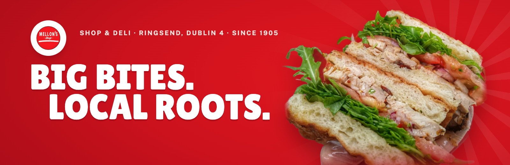
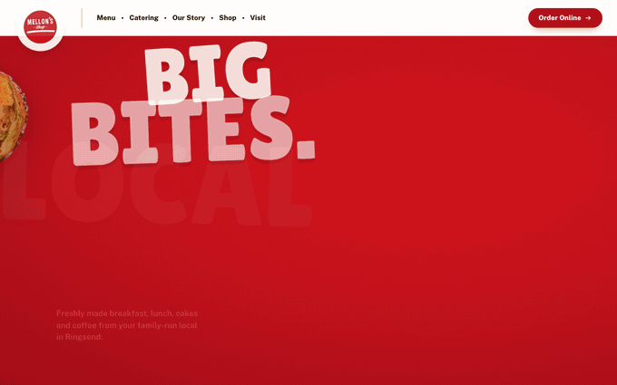
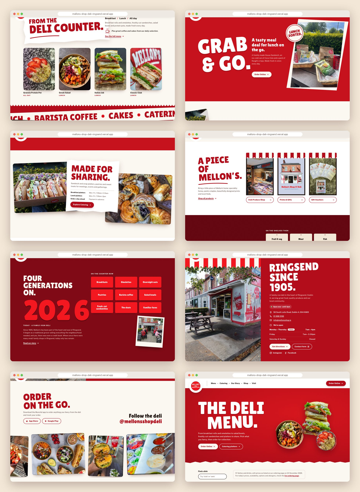
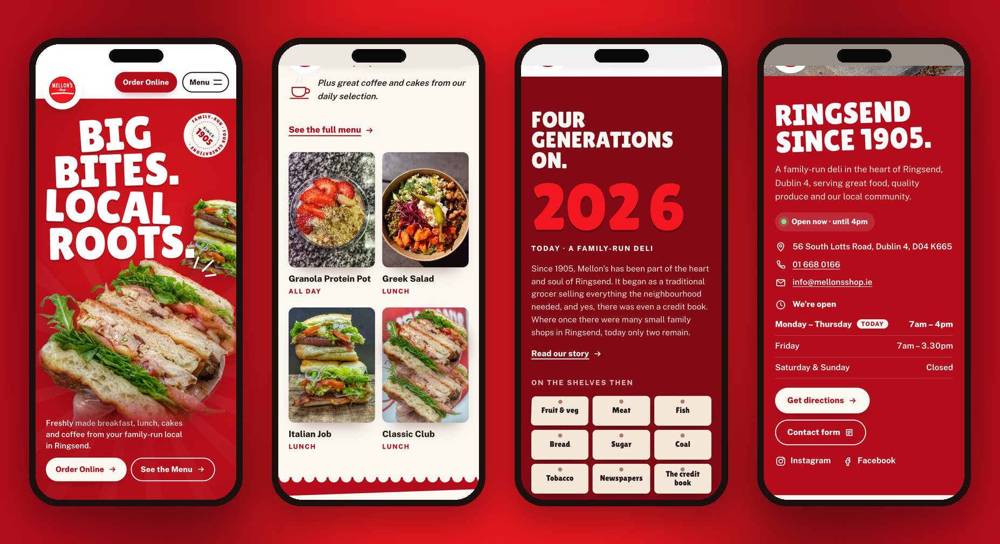
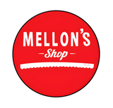

<div align="center">



<h3>A website for a family-run Dublin deli, built around one sandwich that drops onto the poster and then lands on the menu.</h3>

<p>
  <a href="https://mellons-shop-deli-ringsend.vercel.app"><strong>🌐 Live site</strong></a>
  &nbsp;·&nbsp;
  <a href="#hero-animation"><strong>🎬 How the hero works</strong></a>
  &nbsp;·&nbsp;
  <a href="#getting-started"><strong>🛠️ Run it locally</strong></a>
</p>

<p>
  <a href="https://mellons-shop-deli-ringsend.vercel.app"></a>
  
  
  
  
</p>

</div>

<br />

## 🚀 Overview

**Mellon's Shop & Deli** has been part of Ringsend since 1905: a grocer first, a family-run deli today. The site is built as a **deli poster that comes to life**. "Big Bites. Local Roots." stamps onto the red, the Classic Club **drops from above the screen**, lands with a squash and a shake, and then leaves the poster to **land on its own card** on the deli counter. Every section below gets its own moment tied to the shop: awnings unroll, shutters rise, and a 1905 odometer rolls to today while the old shelf labels flip into what's on the counter now.

The page walks visitors from the first impression to the official **Order Online** page in a few scrolls, with the opening hours, the shop and the story on the way.

- **Cinematic first impression**: real cut-outs of the deli's own sandwiches on a scaled poster stage, no video
- **Clear path to ordering**: every *Order Online* goes to the deli's live ordering page; a separate menu page lists the 57 dishes with search
- **Built for every visitor**: complete without JavaScript, still with reduced motion, a pause-motion toggle in the footer, full keyboard support
- **Light**: 0.60 MB on a phone's first load, measured in the browser

<br />

<a name="hero-animation"></a>

## 🎬 The hero animation

<div align="center">
  <a href="https://mellons-shop-deli-ringsend.vercel.app"></a>
  <sub>Captured from the running site at 1440 × 900 · the load is stepped frame by frame, the scroll is real</sub>
</div>

<br />

The drop plays once on load (about two seconds), then the hero pins for 0.75 screen heights (0.5 on phones and portrait tablets):

| Moment            | What happens                                                                                                 |
| :---------------- | :----------------------------------------------------------------------------------------------------------- |
| Load 0–0.9 s      | **Big / Bites. / Local / Roots.** stamp in one word at a time; the wrap and the Italian Job fly in from the edges |
| Load 0.2–1.4 s    | The **Classic Club** falls from above the screen, squashes on impact at 0.84 s, rebounds and settles; the title shakes |
| Load 0.9–1.6 s    | The *Since 1905* seal stamps in with a spin; hand-drawn marks draw themselves around the sandwich             |
| Scroll 0–100% pin | The words fly apart, the side sandwiches and seal leave, the Classic Club comes closer and the burst grows    |
| After the pin     | The sandwich leaves the poster and flies onto the **Classic Club** card in *From the Deli Counter*; the card's photo develops beneath it |

**Under the hood**

- 🍞 **Real cut-outs.** The sandwiches are cut out of the deli's own photos with an ISNet segmentation model (`scripts/cutout.py`, ONNX Runtime), softened at the edges and exported to WebP at 560, 900 and 1300 px.
- 📐 **One poster, any screen.** The hero is a 1024 × 660 stage measured in a unit `--hu = min((100svh − header) / 660, 100vw / 1120, 1.5px)`, so the whole poster always fits one screen. Phones and portrait tablets switch to a tall 390 × 760 composition.
- 🎯 **A landing that hits the card.** A fixed "flyer" is placed every frame between two live measurements: the hero slot and the subject of the card photo. Its scroll trigger is refreshed after the hero pin (`refreshPriority: -1`), so the landing stays exact after any resize or rotation.
- 🐢 **Graceful by default.** Without JavaScript or with `prefers-reduced-motion`, the poster is complete and still; the *Pause motion* button in the footer does the same and is remembered between visits.

<br />

## 🖥️ Sections

<div align="center">
  
</div>

<br />

| #   | Section                          | Anchor         | Role                                                                                               |
| :-- | :------------------------------- | :------------- | :------------------------------------------------------------------------------------------------- |
| 01  | **Big Bites. Local Roots.**      | n/a            | The drop, then the first *Order Online*                                                            |
| 02  | **From the Deli Counter.**       | `#menu`        | Breakfast, lunch and all-day favourites; the paper title unfolds and the plates slide along the counter |
| 03  | Ticker                           | n/a            | Two crossing tapes that speed up and lean with the scroll                                         |
| 04  | **Grab & Go.**                   | `#grab-and-go` | The meal deal: the paper window opens from a slit and a *Lunch sorted.* stamp lands                |
| 05  | **Made for Sharing.**            | `#catering`    | Catering platters, order windows and rules; the trays slide in and the panel unfolds              |
| 06  | **A Piece of Mellon's.**         | `#shop`        | Irish produce, prints and gift vouchers behind three shop windows: awnings unroll, shutters rise   |
| 07  | **Four Generations On.**         | `#our-story`   | Pinned on desktop: 1905 rolls to today and nine shelf labels flip from *then* to *now*            |
| 08  | **Ringsend since 1905.**         | `#visit`       | Address, phone, email, today's hours with *Open now / Closed now* in Dublin time, directions      |
| 09  | **Order on the go.**             | n/a            | The Munchd app and an Instagram strip that scrubs sideways                                        |
| 10  | Footer                           | n/a            | The MELLON'S wordmark rises letter by letter; links, hours, socials, *Pause motion*               |
| +   | **The deli menu.** (`/menu`)     | `#menu-list`   | 57 dishes in 8 groups with prices, search, a category rail and the printable PDF                   |

<br />

## 📱 Mobile first, motion optional

<div align="center">
  
</div>

<br />

- A tall poster made for the phone: name, promise, the sandwich and *Order Online* in the first screen at 360, 375 and 390 px
- The story is not pinned on phones; the year and the shelf each animate while they are on screen
- Shop windows become a swipeable row; buttons are at least 44 px tall; no horizontal scroll down to 360 px
- Nothing depends on hover

<br />

## ✨ Highlights

- **🎞️ An authored moment per section**: GSAP ScrollTrigger scenes, each tied to the shop (counter, paper, awning, shutter, shelf label), never a generic fade-up
- **🕖 Live opening status**: today's row and *Open now · until 4pm* are computed in **Europe/Dublin** time, wherever the visitor is
- **🔎 Searchable menu page**: generated from a dated snapshot of the ordering page (`docs/menu-snapshot.json`), accent-insensitive search, category rail that follows the reader
- **🧭 Adaptive header**: hides on the way down, returns on the way up, full-screen menu on phones (Escape closes it)
- **♿ Accessible components**: skip link, one `h1`, labelled landmarks, live search status, visible focus on every surface, themed selection and scrollbar
- **✅ Browser-tested**: `npm run qa` runs 237 checks at eight screen sizes (overflow, hero fit, landing of the sandwich, anchors, real clicks, links, facts, reduced motion, no JavaScript, phone weight)
- **🔎 Ready to share**: Open Graph image, structured data (`Restaurant`), canonical URL and favicons

<br />

## 💻 Tech stack

| <br />HTML5 | <br />CSS3 | <br />JavaScript | <br />GSAP 3 | <br />Python | <br />Vercel |
| :---: | :---: | :---: | :---: | :---: | :---: |

### Why this stack?

- **Static HTML, CSS and plain JavaScript**: a local business site doesn't need a framework runtime or a build step; `site/` is what gets served
- **GSAP ScrollTrigger (vendored)**: pinning, scrubbing and refresh handling that stay solid across screen sizes, with no CDN request
- **Python for the assets**: cut-outs, WebP sizes and the menu page are generated by scripts, so they can be rebuilt when the photos or prices change
- **Self-hosted Lilita One and Public Sans**: the poster voice and a clear reading face, without third-party font requests
- **Vercel**: every push to `main` deploys automatically

<br />

## 🎨 Design system

| Token     | Value                                                                        | Use                                                   |
| :-------- | :--------------------------------------------------------------------------- | :---------------------------------------------------- |
| Deli red  |   | Year digits, *now* labels, ticker, accents            |
| Red       |   | Buttons, headings on paper, visit panel               |
| Deep      |   | Story background, footer                              |
| Deeper    |   | Story start, shadows                                  |
| Paper     |   | Counter, catering, feed, menu                         |
| Paper 2   |   | *Then* shelf labels, paper surfaces                   |
| Ink       |   | Body text                                             |
| Blush     |   | Text on the red poster                                |

- **Type**: Lilita One for the poster, headings and odometer; Public Sans for everything read. Body 16 px with 1.55 line height
- **Grid**: a 1024-unit frame where `--u = min(100vw / 1120, 100svh / 760, 1.45px)`, so sections scale with the window height as well as the width
- **Rhythm**: one authored scroll moment per section; pins only where the story needs them (hero 0.75 screens, story 1.3 screens on desktop)
- **Motion**: entrances ease out (`expo.out`, `power3.out`), travel eases in-out, loops are linear; nothing is required to read the page

<br />

<a name="getting-started"></a>

## 🛠️ Getting started

```bash
# Clone the repository
git clone https://github.com/Jeanfr1/Mellons-Shop-Deli-Website.git
cd Mellons-Shop-Deli-Website

# Install the test tooling (Node 20+)
npm install

# Serve the site  →  http://localhost:4472
npm run dev

# Rebuild the WebP images and the menu page (Python 3 with Pillow and NumPy)
npm run assets

# Rebuild only the menu page after editing docs/menu-snapshot.json
npm run menu

# Browser QA: 237 checks at eight sizes (QA_BASE=https://… tests the live site)
npm run qa

# Regenerate the README images and the Open Graph image
npm run readme
npm run og
```

<br />

## 📁 Project structure

```
Mellons-Shop-Deli-Website/
├── site/                         # Everything Vercel serves
│   ├── index.html                # Hero → counter → ticker → grab & go → catering → shop → story → visit → feed → footer
│   ├── menu.html                 # The deli menu (generated by scripts/build-menu.py)
│   ├── styles.css                # Tokens, poster stage, sections, tablet and phone layouts, menu page
│   ├── app.js                    # Header, Dublin hours, the drop, the landing, every scroll scene, pause motion
│   ├── menu.js                   # Search, category rail, arrival
│   ├── vendor/                   # GSAP 3.13 + ScrollTrigger
│   └── assets/                   # WebP photos and cut-outs (generated), fonts, logo, og.jpg
├── scripts/
│   ├── cutout.py                 # ISNet segmentation → subject masks
│   ├── prepare-images.py         # Crops, cut-outs and WebP sizes + manifest.json
│   ├── build-menu.py             # docs/menu-snapshot.json → site/menu.html
│   ├── qa.mjs                    # Browser QA (Playwright)
│   └── readme-assets.mjs, readme-compose.py, og.mjs, look.mjs, shots.mjs
├── images/                       # Source photos (official site and provided) and cut-out masks
├── docs/                         # Business sources, menu snapshot, scale contract, validation notes
├── references/                   # Approved board, pre-production direction, printed menu
├── brand/, fonts/, roteiros/     # Brand kit, font sources and the scripts from the kit
├── dist/                         # The kit's prototype, kept for reference (not deployed)
└── vercel.json                   # Static output from site/, clean URLs, cache and robots headers
```

<br />

## 🚀 Deployment

Hosted on **Vercel** and connected to this repository: every push to `main` ships to production.

**Live site:** [mellons-shop-deli-ringsend.vercel.app](https://mellons-shop-deli-ringsend.vercel.app)

| Setting          | Value          |
| :--------------- | :------------- |
| Framework        | Other (static) |
| Build command    | none           |
| Output directory | `site`         |

The preview is `noindex` (meta tag and `X-Robots-Tag` header) until the client approves it.

<br />

## 📌 Content checklist

Items waiting on the client. Each one is marked `TODO(mellons)` in the code.

- [ ] Approve the site, then remove `noindex` (in `site/index.html`, `scripts/build-menu.py` and `vercel.json`) and point the domain here
- [ ] Move `canonical`, `og:url` and `og:image` to the client's domain
- [ ] Recheck the catering order windows and rules (copied from the live ordering page on 24 November 2026)
- [ ] Link the Privacy Policy in the footer once its page is confirmed
- [ ] Refresh `docs/menu-snapshot.json` when prices change, then run `npm run menu`

Choices made where the kit and the current site disagreed:

- The counter shows **four** plates instead of three: the Classic Club was added as the card the hero sandwich lands on
- *Our Story* is its own section (1905 → today) rather than a line inside *Visit*
- The Irish Produce window uses the in-store photo of the counter, the closest real image of the produce shop
- The sweet platter and overnight oats appear as photos on the menu page, not as hero cut-outs

<br />

## 🙏 Acknowledgments

- **Mellon's Shop & Deli** for the photos, the menu and four generations of Ringsend
- **[GSAP](https://gsap.com)** for the scroll engine
- **[ISNet / DIS](https://github.com/xuebinqin/DIS)** and **[ONNX Runtime](https://onnxruntime.ai)** for the cut-outs
- **[Lilita One](https://fonts.google.com/specimen/Lilita+One)** by Juan Montoreano and **[Public Sans](https://fonts.google.com/specimen/Public+Sans)** by USWDS (OFL)
- **[Vercel](https://vercel.com)** for hosting

<br />

---

<div align="center">
  
  <p><strong>Big Bites. Local Roots.</strong></p>
  <p>Built with ❤️ by <a href="https://github.com/Jeanfr1">Jean</a> for Mellon's Shop &amp; Deli</p>
  <sub>© 2026 Mellon's Shop &amp; Deli. All rights reserved.</sub>
</div>
